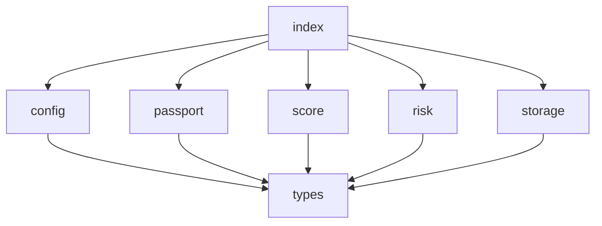

# Design Document

## Overview

Passport Core is a TypeScript library living in the `skeleton/` npm workspace package. It provides a config-driven engine that any industry app can import to validate configs, construct and validate passports, compute readiness scores, evaluate risk rules, and persist passports to disk.

The design has two key priorities:
- **Purity first**: every domain function (config loading, passport validation, scoring, risk evaluation) is a pure function. The only code with side effects is `JsonStorage`.
- **Single public entry point**: all types and functions apps need come from `skeleton/index.ts`. Nothing internal is exported.

The engine is stateless. It takes data in, returns data out. Apps are responsible for orchestrating storage and deciding what to do with results.

## Architecture

The package is a single npm workspace module (`skeleton/`) with this internal structure:

```
skeleton/
  src/
    types.ts      ← all shared types
    config.ts     ← loadConfig (pure)
    passport.ts   ← effectiveStatus, validatePassport (pure)
    score.ts      ← computeScore (pure)
    risk.ts       ← evaluateRisks (pure)
    storage.ts    ← StorageInterface + JsonStorage
    index.ts      ← public re-exports (loadConfig, parsePassport, effectiveStatus, validatePassport, computeScore, evaluateRisks, StorageInterface, JsonStorage, all types)
  package.json
  tsconfig.json
```

Dependency flow:



No module imports from an app. Apps only import from `skeleton/index.ts`. Industry-specific words never appear in skeleton source.

## Components and Interfaces

### loadConfig

```ts
function loadConfig(raw: unknown): IndustryConfig
```

Validates the raw value against the `IndustryConfig` shape. Throws on the first validation error (fail-fast). Checks in order:

1. Required top-level keys present (`name`, `fields`, `proofDocumentTypes`, `riskRules`).
2. `name` length 1–100.
3. `fields` is an array of 1–200 entries; each entry has all five required field-level props (`key`, `label`, `type`, `required`, `proofRequired`) with valid values and no duplicate keys.
4. `proofDocumentTypes` is an array of 0–50 strings, each 1–100 chars.
5. `riskRules` is an array of 0–100 entries; each entry has a valid `condition.field` that exists in the validated field set.

Returns the validated `IndustryConfig` on success.

### effectiveStatus

```ts
function effectiveStatus(entry: FieldEntry): FieldStatus
```

Pure function centralising the effective-status rule used by passport validation, scoring, and risk evaluation:

```ts
function effectiveStatus(entry: FieldEntry): FieldStatus {
  if (entry.value === null) return "missing"
  if (entry.status === "proven" && entry.proofLinks.length === 0) return "claimed"
  return entry.status
}
```

A Config field absent from `Passport.fields` also has effective status `"missing"`.

### parsePassport

```ts
function parsePassport(raw: unknown): Passport
```

Pure function that validates the full runtime shape of a `Passport` object and throws a clear, descriptive `Error` if any field is missing, has the wrong type, or violates structural constraints (e.g., invalid `productId` pattern, `status` not one of the three allowed values). Returns the typed `Passport` on success.

This function is:
- Used internally by `JsonStorage.load` to validate what was read from disk.
- Exported from `index.ts` so apps can call it on form or file input before passing data to other engine functions.

The check order mirrors the `Passport` type:
1. Top-level shape: `productId` present and matches `/^[A-Za-z0-9_-]{1,100}$/`, `configName` is a non-empty string, `fields` is a plain object.
2. For each entry in `fields`: `value` is string or null, `status` is one of `"proven" | "claimed" | "missing"`, `proofLinks` is an array of 0–100 entries.
3. For each `ProofLink`: `url` is a non-empty string ≤2048 chars, `label` is a non-empty string ≤256 chars, `documentType` is a non-empty string.

Throws synchronously with a message naming the offending path (e.g., `"fields.material.proofLinks[0].url: must be a non-empty string"`).

### validatePassport

```ts
function validatePassport(passport: Passport, config: IndustryConfig): ValidationIssue[]
```

Iterates all Config fields, then checks Passport-only fields. Returns all issues found in a single pass (not fail-fast). One `ValidationIssue` per violated rule per field key.

Checks in order per Config field:

| issueType | Condition |
|---|---|
| `missing-required` | field is `required` **and** effective status is `"missing"` |
| `proof-required` | field is `proofRequired` **and** effective status is not `"proven"` |
| `proof-status-conflict` | recorded `status === "proven"` and `proofLinks` is empty |
| `value-status-conflict` | `value === null` and recorded `status !== "missing"` |
| `invalid-value` | `value` is non-null and fails the type-format check for the field's `type` |
| `unknown-proof-type` | any ProofLink has a `documentType` not in `config.proofDocumentTypes` |
| `invalid-proof-link` | any ProofLink `url` is not an absolute URL with protocol `http:` or `https:` |

After iterating Config fields:

| issueType | Condition |
|---|---|
| `unknown-field` | Passport `fields` key not present in Config |

Type-format rules for `invalid-value`:
- `number`: value must match `/^-?\d+(\.\d+)?$/` exactly (no leading zeros for integer part except `0` itself is allowed, no exponent notation).
- `date`: value must match `/^\d{4}-\d{2}-\d{2}$/` **and** survive a round-trip check — parse to a `Date` object, format back as `YYYY-MM-DD` using UTC fields, and compare equal to the original string. This rejects calendar-impossible dates like `2026-02-31`.
- `url`: parseable as an absolute URL via `new URL(value)` with protocol `http:` or `https:` only.
- `text`: no check.

### computeScore

```ts
function computeScore(passport: Passport, config: IndustryConfig): number
```

Iterates `config.fields`. For each field, looks up the entry in `passport.fields` (absent = effective status `"missing"`). Accumulates `earned` and `total`:

```
required field: weight = 2
optional field: weight = 1

proven  → earned += weight
claimed → earned += weight * 0.5
missing → earned += 0

total += weight (for every field)

score = total === 0 ? 0 : Math.floor(100 * earned / total)
```

> `Math.floor` is used (not `Math.round`) so that the score only reaches 100 when every Config field has effective status `proven`. With `Math.round`, a Passport with one claimed field could round up to 100 when the total weight is large enough.

Returns an integer in `[0, 100]`.

### evaluateRisks

```ts
function evaluateRisks(passport: Passport, config: IndustryConfig): string[]
```

Iterates `config.riskRules`. For each rule evaluates its condition using `effectiveStatus`:

| predicate | satisfied when |
|---|---|
| `fieldMissing` | effective status of `condition.field` is `"missing"` |
| `fieldNotProven` | effective status of `condition.field` is not `"proven"` |

Collects `rule.flag` strings for all satisfied conditions, deduplicates, and returns. Unknown field references are caught at `loadConfig` time and never reach this function.

### StorageInterface

```ts
export interface StorageInterface {
  save(passport: Passport): Promise<void>
  load(productId: string): Promise<Passport | null>
  list(): Promise<string[]>
}
```

### JsonStorage

```ts
export class JsonStorage implements StorageInterface {
  constructor(directory: string) {}
  save(passport: Passport): Promise<void>
  load(productId: string): Promise<Passport | null>
  list(): Promise<string[]>
}
```

One JSON file per Passport named `<productId>.json` inside the configured directory. The directory is created on first write if it does not exist.

**Path safety**: before any file I/O, `productId` is validated against `/^[A-Za-z0-9_-]{1,100}$/`. Then the resolved file path is checked to confirm it starts with the resolved directory path. Any violation rejects the operation before touching the filesystem.

**save**: serialises the full Passport to JSON and writes atomically (write to temp file, rename). The temp file is named `<productId>.tmp` (not `.json`) to ensure it is excluded from `list` results. On I/O error the Promise rejects; the previously stored file is unchanged.

**load**: reads the JSON file, parses the JSON string, and passes the result to `parsePassport`. Returns the validated `Passport`. Returns `null` if the file does not exist. Rejects with a descriptive error if JSON parsing fails or `parsePassport` throws.

**list**: reads the directory, filters to filenames ending in `.json`, strips the `.json` suffix to get the stem, then keeps only stems that match `/^[A-Za-z0-9_-]{1,100}$/`. Returns the matching stems as `productId` strings. This excludes temp files and any stray files.

## Data Models

### FieldType and FieldStatus

```ts
type FieldType = "text" | "number" | "date" | "url"
type FieldStatus = "proven" | "claimed" | "missing"
```

### FieldDefinition

```ts
interface FieldDefinition {
  key: string            // 1–50 chars
  label: string          // 1–100 chars
  type: FieldType
  required: boolean
  proofRequired: boolean
}
```

### RiskCondition and RiskRule

```ts
type RiskCondition =
  | { predicate: "fieldMissing";   field: string }
  | { predicate: "fieldNotProven"; field: string }

interface RiskRule {
  flag: string
  condition: RiskCondition
}
```

### IndustryConfig

```ts
interface IndustryConfig {
  name: string              // 1–100 chars
  fields: FieldDefinition[] // 1–200 entries, unique keys
  proofDocumentTypes: string[]  // 0–50 strings, each 1–100 chars
  riskRules: RiskRule[]     // 0–100 entries
}
```

### ProofLink

```ts
interface ProofLink {
  url: string           // non-empty, ≤2048 chars, absolute URL with http: or https: protocol
  label: string         // non-empty, ≤256 chars
  documentType: string  // non-empty; must match a proofDocumentType in the Config
}
```

### FieldEntry

```ts
interface FieldEntry {
  value: string | null
  status: FieldStatus
  proofLinks: ProofLink[]  // 0–100 entries
}
```

### Passport

```ts
interface Passport {
  productId: string    // /^[A-Za-z0-9_-]{1,100}$/
  configName: string
  fields: Record<string, FieldEntry>
}
```

### ValidationIssue

```ts
type IssueType =
  | "missing-required"
  | "proof-required"
  | "proof-status-conflict"
  | "value-status-conflict"
  | "unknown-field"
  | "unknown-proof-type"
  | "invalid-value"
  | "invalid-proof-link"

interface ValidationIssue {
  fieldKey: string
  issueType: IssueType
}
```


## Correctness Properties

*A property is a characteristic or behavior that should hold true across all valid executions of a system — essentially, a formal statement about what the system should do. Properties serve as the bridge between human-readable specifications and machine-verifiable correctness guarantees.*

### Property 1: Config validation round-trip

*For any* structurally valid `IndustryConfig`, serialising it to JSON, parsing the JSON back to `unknown`, and calling `loadConfig` on the result produces a config with the same number of field entries and identical `key`, `type`, and `label` values at every index.

**Validates: Requirements 2.7**

### Property 2: Score range

*For any* `Passport` and `IndustryConfig`, `computeScore` returns an integer in the closed range `[0, 100]`.

**Validates: Requirements 5.1**

### Property 3: Score determinism

*For any* `Passport` and `IndustryConfig`, calling `computeScore` twice with the same arguments returns the same integer both times.

**Validates: Requirements 5.8**

### Property 4: Monotonicity — missing to claimed

*For any* `Passport`, `IndustryConfig`, and field key present in the config, if the field currently has effective status `"missing"` and that field's entry is changed to have a non-null value with status `"claimed"`, the score returned by `computeScore` is greater than or equal to the score before the change.

**Validates: Requirements 5.9**

### Property 5: Monotonicity — claimed to proven

*For any* `Passport`, `IndustryConfig`, and field key present in the config, if the field currently has effective status `"claimed"` and that field's entry is changed to have status `"proven"` with at least one proof link, the score returned by `computeScore` is greater than or equal to the score before the change.

**Validates: Requirements 5.10**

### Property 6: Storage round-trip

*For any* valid `Passport` (productId matching `/^[A-Za-z0-9_-]{1,100}$/`), calling `JsonStorage.save` followed by `JsonStorage.load` with the same `productId` returns a `Passport` that is deeply equal to the saved one — every field, status, value, and proof link is preserved.

**Validates: Requirements 7.8, 7.9**

### Property 7: Score is 100 iff every Config field is proven

*For any* `Passport` and `IndustryConfig`, `computeScore` returns `100` **if and only if** every field declared in the Config has effective status `"proven"` for that Passport.

**Validates: Requirements 5.5**

### Property 8: validatePassport never throws for any parsed Passport

*For any* `Passport` returned by `parsePassport` (i.e., any structurally valid Passport), calling `validatePassport(passport, config)` with any `IndustryConfig` returns an array and never throws.

**Validates: Requirements 4.1, 4.10**

### Property 9: fieldMissing flags are a subset of fieldNotProven flags

*For any* `Passport` and `IndustryConfig`, every `RiskFlag` raised by a `fieldMissing` condition on a given field is also raised by a `fieldNotProven` condition on the same field (when such a rule exists). Formally: if effective status is `"missing"`, it is also not `"proven"`.

**Validates: Requirements 6.2, 6.3**

### Property 10: JsonStorage rejects invalid productIds with no file created

*For any* string that does not match `/^[A-Za-z0-9_-]{1,100}$/`, calling `JsonStorage.save` with that string as `productId` rejects the Promise and creates no file in the configured directory.

**Validates: Requirements 7.6**

### Property 11: parsePassport round-trip

*For any* valid `Passport`, `parsePassport(JSON.parse(JSON.stringify(passport)))` returns a `Passport` that is deeply equal to the original.

**Validates: Requirements 3.1**

## Error Handling

### loadConfig

| Error condition | Behaviour |
|---|---|
| Missing top-level key | Throws `Error` naming the missing key |
| `name` out of length bounds | Throws `Error` naming `name` and the violated constraint |
| `fields` entry missing sub-property | Throws `Error` naming the entry (key or index) and missing property |
| `fields` entry has invalid `type` | Throws `Error` naming the entry and the invalid value |
| Duplicate field key | Throws `Error` naming the duplicate key |
| `riskRules` entry references unknown field | Throws `Error` naming the rule's flag and the unknown field key |

All errors are thrown synchronously. `loadConfig` never returns a partial config.

### validatePassport

Returns an array; never throws for domain errors. All issues are collected in a single pass. Apps that receive Passport data from external sources (file input, form data) should call `parsePassport` first to validate the shape before passing the value to `validatePassport` or `computeScore`.

### computeScore / evaluateRisks

Pure functions; no error conditions. Edge cases (no fields, all missing) return defined values (0).

### JsonStorage

| Error condition | Behaviour |
|---|---|
| `productId` fails regex | Rejects the Promise with an `Error` before any I/O |
| Resolved path escapes configured directory | Rejects the Promise with an `Error` |
| `save` I/O failure | Rejects with the underlying OS error; previously stored file unchanged |
| `load` file not found | Resolves to `null` |
| `load` JSON parse failure or invalid Passport shape | Rejects with an `Error` describing the corrupt record |
| Configured directory does not exist on first `save` | Directory is created recursively; then write proceeds |

Errors from `fs` calls propagate without wrapping unless a richer message is needed (e.g., corrupt record).

## Testing Strategy

### Unit tests (Vitest)

Unit tests cover specific examples and all error/edge conditions:

- `loadConfig`: one test per invalid input shape (each missing top-level key, invalid name length boundaries, duplicate field key, invalid field type, invalid risk rule field reference).
- `validatePassport`: one test per `issueType` to confirm the right issue is returned; a test confirming all issues are collected in one pass for a multi-violation passport; a test confirming an empty list for a fully valid passport.
- `computeScore`: tests for all-proven → 100, all-missing → 0, mixed (known inputs with computed expected value), no-fields → 0.
- `evaluateRisks`: one test per predicate type (`fieldMissing`, `fieldNotProven`); deduplication test; empty-result test.
- `JsonStorage`: save then load round-trip (integration-style, using `tmp` directory); overwrite; load missing → null; invalid productId → rejection; corrupt file → rejection.

### Property-based tests (fast-check)

The property-based tests use [fast-check](https://github.com/dubzzz/fast-check) with a minimum of **100 iterations per property**.

Each test is tagged with a comment in the format:
`// Feature: passport-core, Property N: <property text>`

**Property 1 — Config validation round-trip**
Arbitrary `IndustryConfig` generator produces random configs within schema bounds. For each, `JSON.parse(JSON.stringify(config))` is passed to `loadConfig`. Assert field count and per-index `key`/`type`/`label` match.

**Property 2 — Score range**
Arbitrary `Passport` and `IndustryConfig` generator (config fields may or may not be present in passport). Assert `0 <= computeScore(p, c) <= 100` and `Number.isInteger(computeScore(p, c))`.

**Property 3 — Score determinism**
Same generators as Property 2. Assert `computeScore(p, c) === computeScore(p, c)` (two independent calls, identical inputs via `fc.clone`).

**Property 4 — Monotonicity: missing → claimed**
Generator produces a passport and config where at least one config field has effective status `"missing"`. Record the score. Set that field's entry to `{ value: "x", status: "claimed", proofLinks: [] }`. Assert new score `>=` original score.

**Property 5 — Monotonicity: claimed → proven**
Generator produces a passport and config where at least one config field has effective status `"claimed"` (non-null value, `status: "claimed"`). Record the score. Upgrade to `{ value: same, status: "proven", proofLinks: [{ url: "https://example.com", label: "doc", documentType: config.proofDocumentTypes[0] ?? "proof" }] }`. Assert new score `>=` original score.

**Property 6 — Storage round-trip**
Arbitrary `Passport` generator (valid productId, arbitrary fields/proof links). For each passport, write to a temporary directory via `JsonStorage.save`, then `JsonStorage.load`. Assert deep equality using Vitest's `expect(result).toStrictEqual(original)`.

**Property 7 — Score is 100 iff every field is proven**
Arbitrary `Passport` and `IndustryConfig`. Compute `allProven = config.fields.every(f => effectiveStatus(passport.fields[f.key] ?? absent) === "proven")`. Assert `computeScore(p, c) === 100` iff `allProven`.

**Property 8 — validatePassport never throws**
Arbitrary `Passport` (via `parsePassport`-valid generator) and `IndustryConfig`. Wrap `validatePassport(p, c)` in a try/catch. Assert no exception is thrown and the return value is an array.

**Property 9 — fieldMissing ⊆ fieldNotProven**
Arbitrary `Passport` and `IndustryConfig` where each field has at least one `fieldMissing` rule and one `fieldNotProven` rule pointing to it. For each field where `fieldMissing` fired, assert `fieldNotProven` also fired.

**Property 10 — JsonStorage rejects invalid productIds**
Arbitrary string that fails `/^[A-Za-z0-9_-]{1,100}$/`. Assert `JsonStorage.save({ ...anyPassport, productId: invalidId }, config)` rejects. Assert no `.json` or `.tmp` file is created in the directory.

**Property 11 — parsePassport round-trip**
Arbitrary valid `Passport` generator. Assert `parsePassport(JSON.parse(JSON.stringify(p)))` deeply equals `p`.

### Dual-testing rationale

Unit tests catch concrete bugs with known inputs and verify every error message. Property tests verify invariants across the full input space — especially boundary interactions (e.g., score rounding at half-weights, special characters in field values, proof link edge cases). Both are needed; they are not substitutes for each other.
